<div align="center">


# 📚 KitabKart

### *Buy & sell books, student to student.*

*Kitab* (किताब) means **book**. **KitabKart** is a cart full of books.

**A second-hand book marketplace for college students. Sell your old books to juniors, browse listings, and contact sellers in one click.**


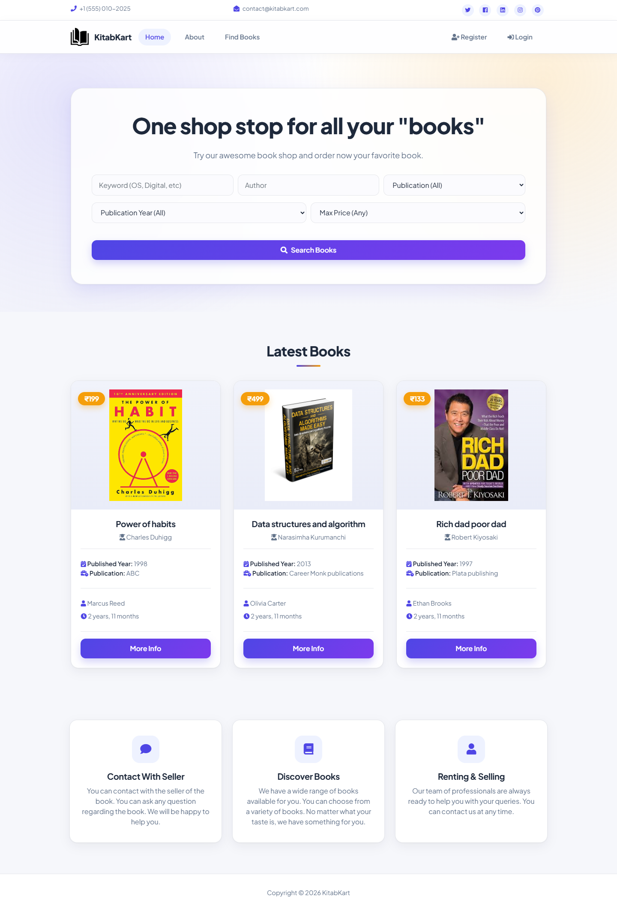

</div>

---

## 📖 Table of contents
- [About](#-about)
- [Features](#-features)
- [Screenshots](#-screenshots)
- [Tech stack](#-tech-stack)
- [Getting started](#-getting-started)
- [Demo accounts](#-demo-accounts)
- [How it works](#-how-it-works)
- [Project structure](#-project-structure)
- [What was fixed](#-what-was-fixed-in-this-version)
- [Configuration](#-configuration)

---

## 💡 About

Every year, seniors finish their courses with a shelf of books that their juniors are about to buy at full price. **KitabKart** is a platform for **buying and selling books** that links the two: sellers list their used books with photos and a price, and buyers search, compare and send the seller an inquiry directly.

Sellers manage everything (books, seller profiles and buyer inquiries) from a branded **Django admin panel**.

---

## ✨ Features

| | Feature | Details |
|:-:|---|---|
| 🏠 | **Home page** | Hero search plus the 3 latest listings |
| 🔍 | **Smart search** | Keyword (title or description), author, publication, year and max-price filters, combinable |
| 📚 | **Book listings** | Paginated cards with cover, price badge, author, publication, seller and listing age |
| 📖 | **Book details** | Large cover, extra photos (front/back cover, pages) in a **lightbox gallery**, full specs and description |
| 👤 | **Seller profile** | Photo, bio, college, branch, passing year and contact email on every listing |
| ✉️ | **Inquiries** | "Make an inquiry" form saves the message and emails the seller (if email is configured) |
| 🔐 | **Accounts** | Register, log in, log out, with duplicate username/email checks |
| 📊 | **Dashboard** | Your inquiries, plus messages from buyers if you are a seller |
| ⭐ | **About page** | Team section and a "Best Seller of the Month" highlight |
| 🛠️ | **Admin panel** | Branded Django admin to manage books, sellers and inquiries, with search, filters and inline publish toggles |
| 📱 | **Responsive** | Works on desktop, tablet and mobile |

---

## 📸 Screenshots

### 🏠 Home: hero search and latest books


### 📚 Browse books
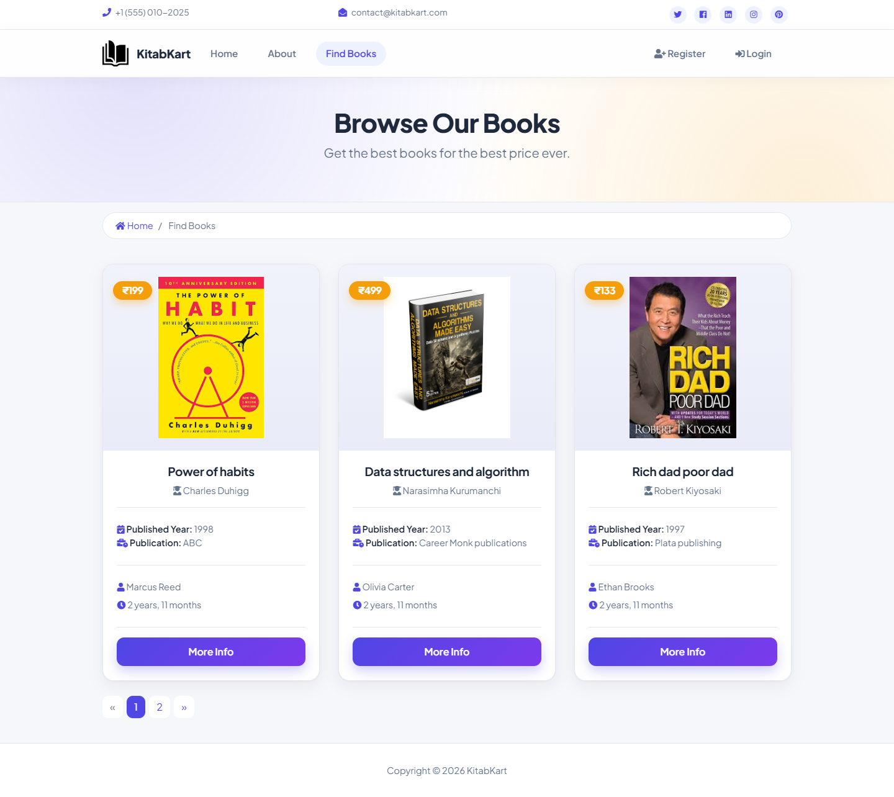

### 📖 Book details, with the seller card
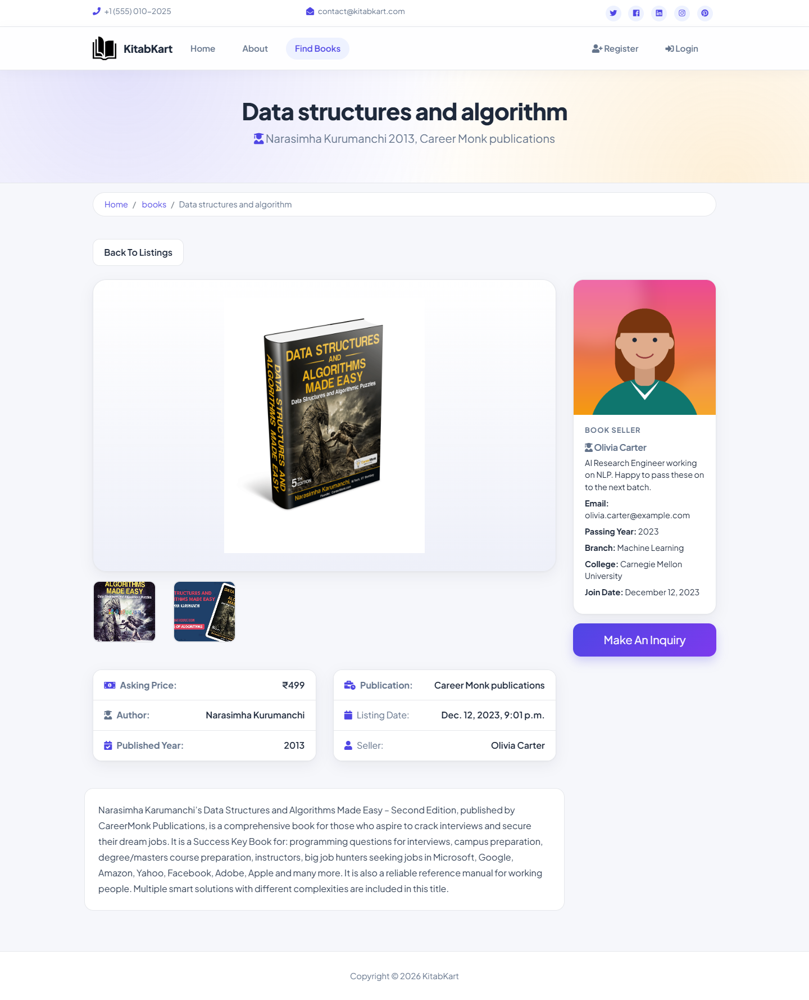

<table>
<tr>
<td width="50%"><b>🖼️ Lightbox photo gallery</b><br>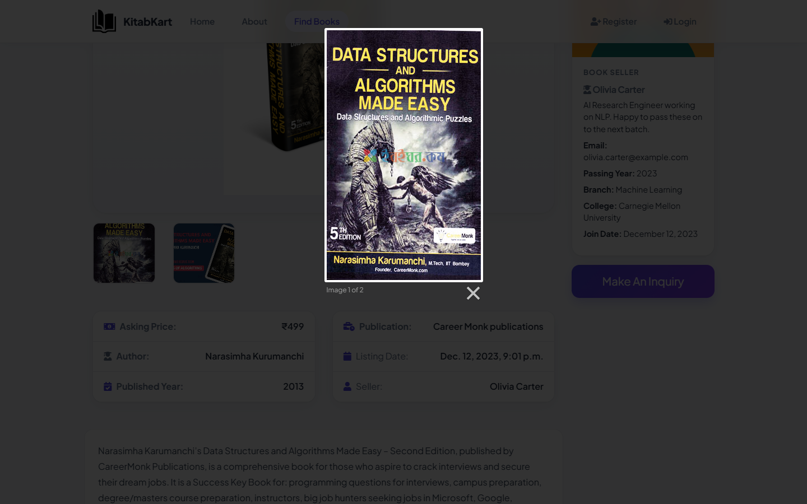</td>
<td width="50%"><b>✉️ Make an inquiry</b><br>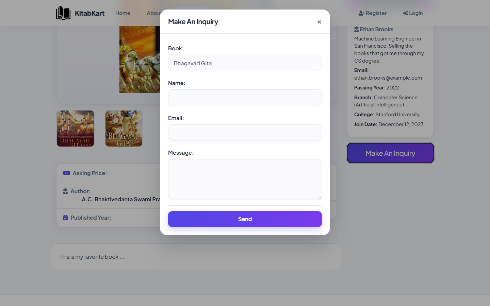</td>
</tr>
</table>

### 🔍 Search results (example: max price ₹200)
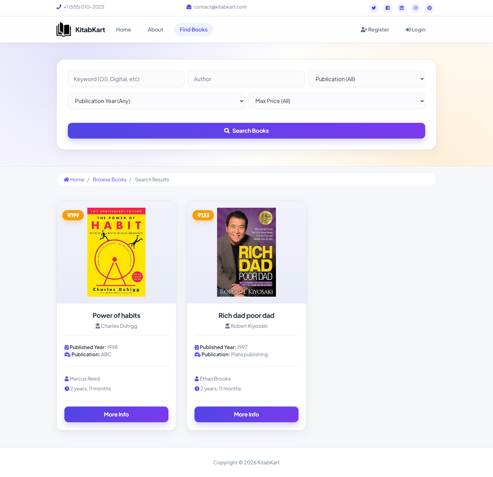

### ⭐ About, team and best seller of the month
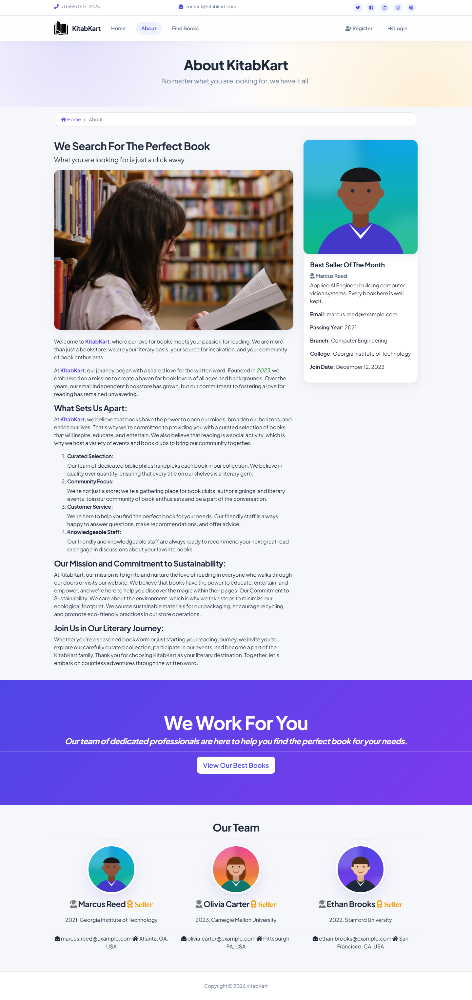

<table>
<tr>
<td width="50%"><b>📝 Register</b><br>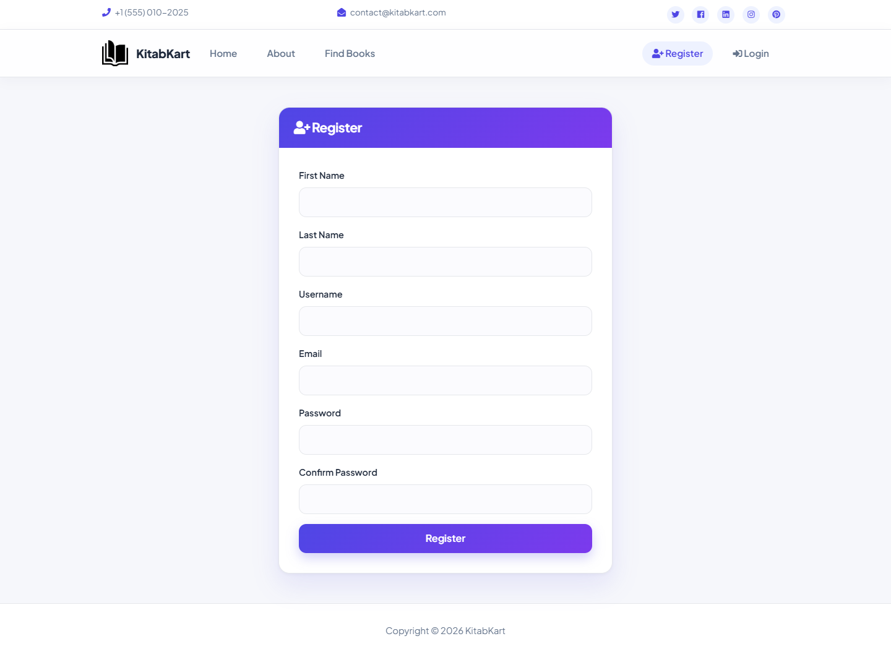</td>
<td width="50%"><b>🔐 Login</b><br>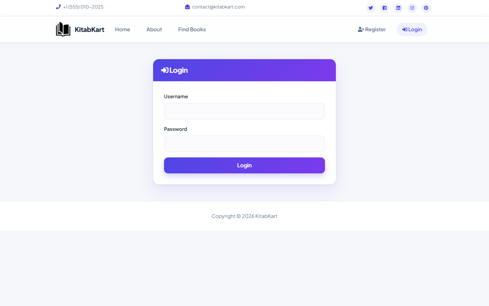</td>
</tr>
<tr>
<td width="50%"><b>📊 User dashboard</b><br>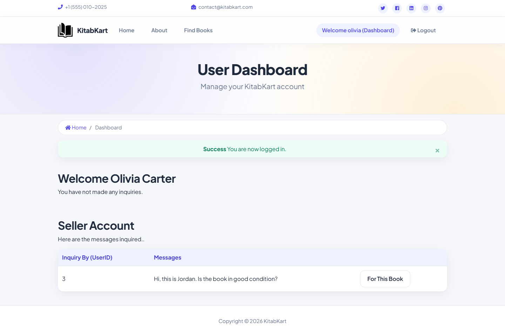</td>
<td width="50%"><b>🛠️ Admin panel login</b><br>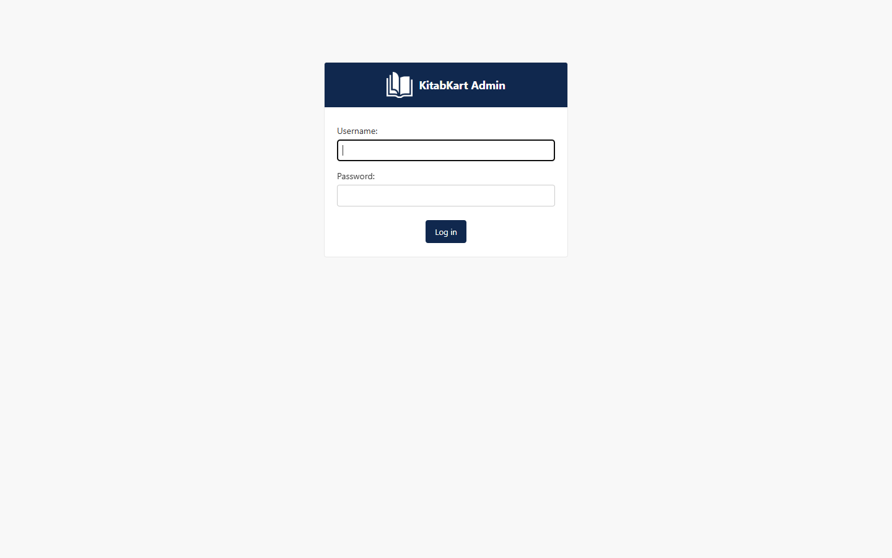</td>
</tr>
</table>

### 📱 Mobile
<p align="center"></p>

---

## 🧰 Tech stack

| Layer | Technology |
|---|---|
| Backend | **Python 3**, **Django 5.2 LTS** |
| Database | **SQLite** (included with demo data) |
| Frontend | Django templates, **Bootstrap 4**, custom light theme (`static/css/theme.css`), Plus Jakarta Sans font |
| Icons and UI | Font Awesome 5, Lightbox2, jQuery |
| Images | **Pillow** (`ImageField` uploads) |
| Email | Django `send_mail` over Gmail SMTP (optional) |

---

## 🚀 Getting started

> Requires **Python 3.10 or newer**. Tested on Python 3.15 with Django 5.2.

```bash
# 1. Get the code
git clone <your-repo-url>
cd KitabKart

# 2. Create and activate a virtual environment
python -m venv venv
venv\Scripts\activate          # Windows
# source venv/bin/activate     # macOS / Linux

# 3. Install dependencies
pip install -r requirements.txt

# 4. Apply database migrations
python manage.py migrate

# 5. Run the development server
python manage.py runserver
```

Open **http://127.0.0.1:8000/** for the site and **http://127.0.0.1:8000/admin/** for the admin panel.

> 💡 The repo includes `db.sqlite3` and `media/` with demo books and sellers, so the site has content as soon as it starts.
> To start fresh, delete `db.sqlite3`, run `migrate`, then `python manage.py createsuperuser`.

---

## 👥 Demo accounts

The bundled database contains these accounts. All people, emails and colleges in the demo data are **fictional**, and the seller pictures are generated illustrations.

| Role | Username | Password |
|---|---|---|
| 🛠️ Admin (superuser) | `admin` | `Admin@12345` |
| 👤 Seller (Olivia Carter, has a buyer message) | `olivia` | `Demo@12345` |
| 👤 Seller (Marcus Reed) | `marcus` | `Demo@12345` |
| 🛒 Buyer (Jordan Hayes) | `jordan` | `Demo@12345` |

> ⚠️ These are demo passwords only. Change them, or start with a fresh database, before deploying anywhere public.

---

## ⚙️ How it works

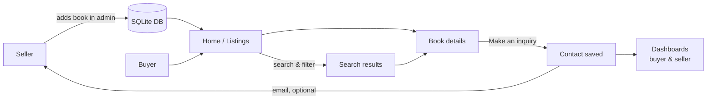

**Data model**

| Model | App | Key fields |
|---|---|---|
| `Seller` | `sellers` | name, photo, about, college, branch, passing year, email, best-seller flag |
| `Book` | `books` | seller (FK), title, author, price, publication, year (1950 to current year), photo, front/back cover, front/back page, published flag |
| `Contact` | `contacts` | book, book id, buyer name/email, message, user id, seller id, date |

---

## 📁 Project structure

```
KitabKart/
├── kitabkart/            # Project settings, root URLs, WSGI/ASGI
├── pages/                # Home & About pages
├── books/                # Book model, listings, detail, search, filter choices
├── sellers/              # Seller model + admin
├── contacts/             # Inquiry model + "Make an inquiry" handler
├── accounts/             # Register, login, logout, dashboard
├── templates/            # base.html, partials (navbar, footer, alerts), page templates, admin branding
├── static/               # CSS (bootstrap, style, theme), JS, images, fonts
├── staticfiles/          # collectstatic output
├── media/                # Uploaded book & seller images (demo data)
├── docs/screenshots/     # README screenshots
├── export_json.py        # Export books, sellers and contacts to data.json
├── db.sqlite3            # Demo database
├── requirements.txt
└── manage.py
```

---

## 🩹 What was fixed in this version

| # | Problem | Fix |
|:-:|---|---|
| 1 | `requirements.txt` was saved as **UTF-16**, so `pip install -r` failed | Re-saved as plain UTF-8 |
| 2 | Django 4.2.6 / Pillow 10.0.1 **crashed on every page** with new Python (`'super' object has no attribute 'dicts'`) | Upgraded to **Django 5.2 LTS** and a current Pillow |
| 3 | **Keyword search crashed** (500), because `union()` of ordered querysets isn't allowed in SQLite and filtering after `union()` isn't supported | Rewritten with `Q(title) \| Q(description)` so every filter combines |
| 4 | Search also showed **unpublished** books | Only published books appear now |
| 5 | Visiting `/accounts/logout/` **crashed** (the view returned nothing on GET) | Always redirects home |
| 6 | **Dashboard** was open to logged-out visitors | `@login_required`, which redirects to login |
| 7 | **Make an inquiry crashed** when email wasn't configured | The inquiry is still saved, and a failed email is logged instead of crashing |
| 8 | **Admin seller search crashed** (searched a non-existent `year` field) | Searches `passing_year` |
| 9 | Search dropdowns listed **duplicate** values | Values are unique and sorted |
| 10 | Logged-in user ID wasn't sent with inquiries (`user.authenticated` typo) | `user.is_authenticated` |
| 11 | Back-page photo never showed (`listing.back_page` typo) | `book.back_page` |
| 12 | Search form didn't remember the selected year or price | Fixed the template comparisons |
| 13 | "Find Books" never highlighted in the navbar | Checks `books` in the URL |
| 14 | "[Your Bookstore's Name]" placeholder text on the About page | Replaced with "KitabKart" |
| 15 | "Realtor:" label (template leftover) on book pages | Renamed to "Seller:" |
| 16 | Timezone warnings (`datetime.now` defaults) | `timezone.now` + migrations |
| 17 | `export_json.py` overwrote its own data, so only sellers were exported | Exports all three models into one file |
| 18 | Debug `print()` in the listings view; missing favicon (404) | Removed / added |

**UI:** a new **modern light theme** with a white glass navbar, light gradient hero, rounded cards with hover lift, amber price badges, an indigo/violet accent and the Plus Jakarta Sans font. It lives in `static/css/theme.css` and only overrides the original styles, so it's easy to tweak or remove.

---

## 🔧 Configuration

**Email (optional).** To email sellers when someone sends an inquiry, set these environment variables (Gmail needs an [App Password](https://support.google.com/accounts/answer/185833)):

| Variable | Purpose |
|---|---|
| `EMAIL_USER` | SMTP login (your Gmail address) |
| `EMAIL_PASS` | Gmail app password |
| `EMAIL_SENDER` | "From" address |
| `EMAIL_RECEIVER` | Extra address that gets a copy of every inquiry |

Without them, inquiries are still saved and shown in the dashboard and admin.

**Export data**
```bash
python manage.py shell < export_json.py     # → data.json
```

**Before deploying:** set `DEBUG = False`, fill in `ALLOWED_HOSTS`, move `SECRET_KEY` to an environment variable, and serve `staticfiles/` and `media/` with your web server.

---

## 👤 Author

**Archit Yadav** · [@ArchitYadav07](https://github.com/ArchitYadav07)

<div align="center">

⭐ If you found this useful, give it a star!

</div>
